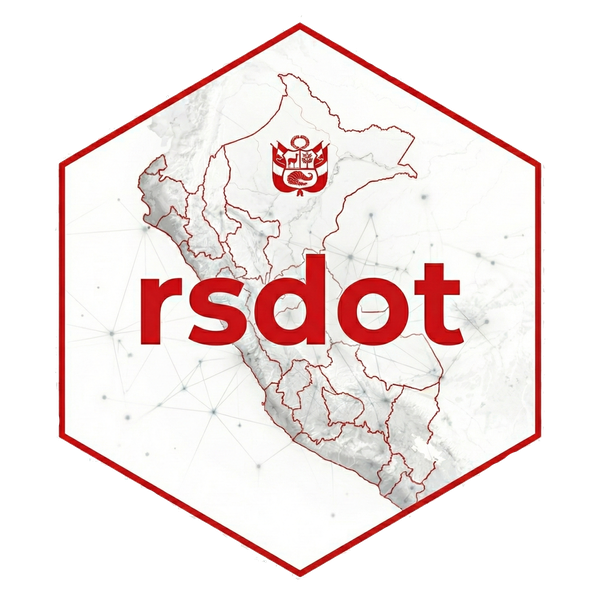

<!-- README.md is generated from README.Rmd. Please edit that file -->

```{r, include = FALSE}
knitr::opts_chunk$set(
  collapse = TRUE,
  comment = "#>",
  fig.path = "man/figures/README-",
  out.width = "100%"
)
```

# rsdot <a href='https://github.com/PaulESantos/rsdot'></a>

<!-- badges: start -->
[](https://lifecycle.r-lib.org/articles/stages.html#experimental)
[](https://CRAN.R-project.org/package=rsdot)
[](https://github.com/PaulESantos/rsdot/actions/workflows/R-CMD-check.yaml)
[](https://app.codecov.io/gh/PaulESantos/rsdot)
<!-- badges: end -->


`rsdot` provides programmatic access to geographic information produced and collected by the Secretariat of Demarcation and Territorial Organization (SDOT) of the Presidency of the Council of Ministers (PCM) of Peru.

The package facilitates access and manipulation of various vector layers, including:

- **INEI 2023 Census Limits**: Departments, provinces, and districts
- **Travel Times**: Territorial accessibility to departmental capitals
- **Population Density and Growth**: Spatial interpolation of 2007-2017 censuses
- **SDOT Geographic Model Information**: Infrastructure, population centers, risks, and hazards
- **Other territorial thematic layers**

### ⚠️ Important

The INEI census limits provided by this package are **referential** and do not constitute official limits nor have legal demarcatory effect.

## ✨ Features

- ✅ **Programmatic access** to official spatial data from Peru
- ✅ **Automatic download** from OSF with intelligent caching
- ✅ **Compatible** with `sf`, `ggplot2`, `dplyr`, and modern GIS tools
- ✅ **Automatic geometry validation** for spatial operations

### 📦 Available Functions by Domain

#### 🏛️ Census Limits and Territorial Organization
- `get_departamentos()` - Departmental census boundaries (INEI 2023).
- `get_provincias(departamento)` - Provincial census boundaries.
- `get_distritos(departamento, provincia)` - District census boundaries.
- `get_capitales()` - Departmental, provincial, and district capital coordinates.
- `get_centros_poblados(departamento, ...)` - Dispersed population centers and settlements.

#### 🛣️ Transportation Networks and Aerodromes
- `get_red_vial_nacional()` - National road network (SINAC / MTC).
- `get_red_vial_departamental(departamento, ...)` - Departmental road network.
- `get_red_vial_vecinal(departamento, ...)` - Local/rural road network.
- `get_aerodromos(departamento)` - Airports and airfields across Peru.

#### 🏥 Social Infrastructure and Public Services
- `get_ipress(departamento, ...)` - Health establishments (IPRESS - MINSA/SDOT).
- `get_locales_educativos(departamento, ...)` - Educational buildings and campuses (MINEDU).
- `get_servicios_educativos(departamento, ...)` - Educational services by level/modality.

#### 📈 Demographics and Territorial Accessibility
- `get_densidad_poblacional(departamento, ...)` - Intercensal population density (2007-2017).
- `get_centros_poblados_crecimiento(departamento)` - Intercensal growth rate for population centers.
- `get_tiempos_desplazamiento(departamento)` - Travel time isochrones and accessibility to capitals.

#### 📶 Telecommunications
- `get_cobertura_movil(departamento, ...)` - Mobile coverage (2G, 3G, 4G, 5G) by population center.
- `get_cobertura_movil_c(departamento, ...)` - Detailed mobile services and base stations.

#### 🌋 Hazards and Disaster Risk Management
- `get_peligros(dataset, departamento)` - Geological hazards, mass movements, and flood zones.
- `get_riesgos(dataset, departamento)` - Disaster risk evaluations and non-mitigable risk zones.

#### ⚙️ Catalog Discovery and Maintenance Utilities
- `list_available_layers(domain = NULL)` - Explore the complete catalog of spatial layers and their metadata.
- `rsdot_check_updates()` - Check status, sizes, and modification dates of cached datasets.
- `clear_rsdot_cache()` - Remove all locally cached datasets to free up space or force updates.

---

### 🗺️ Layer Coverage Matrix (GeoSDOT vs rsdot)

| Domain | GeoSDOT Source Layer | rsdot Function | Granularity / Partition |
| :--- | :--- | :--- | :--- |
| Limits | `geoportal:v_departamentos_2023` | `get_departamentos()` | National |
| Limits | `geoportal:v_provincias_2023` | `get_provincias()` | National / Department |
| Limits | `geoportal:v_distritos_2023` | `get_distritos()` | National / Department / Province |
| Limits | `geoportal:v_capitales` | `get_capitales()` | National / Department |
| Limits | `geoportal:ccpp_asentamientos_dispersos` | `get_centros_poblados()` | Department / Province / District |
| Transport | `geoportal:v_red_vial_nacional` | `get_red_vial_nacional()` | National |
| Transport | `geoportal:v_red_vial_departamental` | `get_red_vial_departamental()` | Department / Province |
| Transport | `geoportal:v_red_vial_vecinal` | `get_red_vial_vecinal()` | Department / Province |
| Transport | `geoportal:v_aerodromos` | `get_aerodromos()` | Department |
| Services | `geoportal:v_ipress` | `get_ipress()` | Department / Province / District |
| Services | `geoportal:v_locales_educativos` | `get_locales_educativos()` | Department / Province / District |
| Services | `geoportal:v_servicios_educativos` | `get_servicios_educativos()` | Department / Province / District |
| Demographics | `geoportal:v_densidad_poblacional` | `get_densidad_poblacional()` | Department / Province / District |
| Demographics | `geoportal:v_ccpp_crecimiento` | `get_centros_poblados_crecimiento()` | Department |
| Accessibility | `geoportal:v_tiempo_desplazamiento` | `get_tiempos_desplazamiento()` | Department / Custom AOI |
| Telecom | `geoportal:cobertura_movil_oper` | `get_cobertura_movil()` | Department / Province / District |
| Hazards | `geoportal:v_peligros_*` | `get_peligros()` | Department |
| Risks | `geoportal:v_riesgos_*` | `get_riesgos()` | Department |
Once the package is on CRAN, you can install it with:
```r
install.packages("rsdot")
```

Or install the development version from GitHub:
```r
# Using remotes
install.packages("remotes")
remotes::install_github("PaulESantos/rsdot")

# Or using pak (recommended)
install.packages("pak")
pak::pak("PaulESantos/rsdot")
```

## 🚀 Usage Examples

### Load the package
```{r }
library(rsdot)
library(sf)
library(ggplot2)
library(dplyr)
```

### 1. Census Limits

#### Get departments
```{r}
deps <- get_departamentos()
deps

# Basic visualization
ggplot(deps) +
  geom_sf(fill = "steelblue", color = "white") +
  theme_minimal() +
  labs(
    title = "Departments of Peru",
    caption = "Source: SDOT - PCM / INEI 2023"
  )
```

#### Get provinces of a department
```{r}
cusco_prov <- get_provincias(departamento = "CUSCO")
head(cusco_prov)

# Province map
ggplot(cusco_prov) +
  geom_sf(aes(fill = nombprov), color = "white", linewidth = 0.3) +
  scale_fill_viridis_d(option = "plasma") +
  theme_minimal() +
  labs(
    title = "Provinces of the Department of Cusco",
    subtitle = "INEI 2023 | Referential",
    fill = "Province"
  )
```

#### Get districts

Example: Cañete (Lima)
```{r}
canete <- get_distritos(
  provincia = "CAÑETE",
  departamento = "LIMA"
)

# Visualization
ggplot(canete) +
  geom_sf(aes(fill = nombdist), color = "white", linewidth = 0.3) +
  scale_fill_viridis_d() +
  theme_minimal() +
  labs(
    title = "Districts of the Province of Cañete",
    subtitle = "INEI 2023 Census Reference",
    fill = "District"
  )
```

### 2. Travel times
```r
# Load Cusco limits
cusco <- get_departamentos(departamento = "CUSCO")

# Get travel times
tiempos_cusco <- get_tiempos_desplazamiento(area_interes = cusco)

# Visualize territorial accessibility
ggplot() +
  geom_sf(data = tiempos_cusco, aes(fill = cat_tiempo), color = NA) +
  geom_sf(data = cusco, fill = NA, color = "black", linewidth = 1) +
  scale_fill_brewer(palette = "YlOrRd", name = "Time", direction = -1) +
  labs(
    title = "Travel Time to Nearest Capital",
    subtitle = "Department of Cusco",
    caption = "Source: INEI - MTC | Visor - SDOT"
  ) +
  theme_void()
```

### 3. Population density and growth

#### See available departments
```{r}
# List departments with available data
get_densidad_poblacional()
```

#### Load data for a department
```{r}
densidad_cusco <- get_densidad_poblacional(departamento = "CUSCO")
densidad_cusco

# Growth level map
ggplot(densidad_cusco) +
  geom_sf(aes(fill = nivel), color = NA) +
  scale_fill_brewer(
    palette = "RdYlGn",
    name = "Growth\nLevel"
  ) +
  labs(
    title = "Population Growth by Level",
    subtitle = "Department of Cusco (2007-2017)",
    caption = "Source: INEI | Visor - SDOT"
  ) +
  theme_minimal()
```

#### Filter by province and district
```{r}
# Load only one province
densidad_prov_cusco <- get_densidad_poblacional(
  departamento = "CUSCO",
  provincia = "CUSCO"
)

# Load specific district
densidad_wanchaq <- get_densidad_poblacional(
  departamento = "CUSCO",
  provincia = "CUSCO",
  distrito = "WANCHAQ"
)
```

#### Advanced Analysis: Map with district labels
```{r}
prov_anta <- get_densidad_poblacional(
  departamento = "CUSCO",
  provincia = "ANTA", 
  distrito = c("CACHIMAYO", "PUCYURA", "ANTA"))

distritos_anta <- prov_anta |>
   group_by(ubigeo, nombdist) |>
   summarise(.groups = "drop")
 distritos_anta
# Calculate centroids for labels
distritos_centroides <- st_point_on_surface(distritos_anta)

# Complete map
ggplot() +
  # 1. Cells with growth level
  geom_sf(
    data = prov_anta,
    aes(fill = nivel),
    color = NA
  ) +
  # 2. District outlines
  geom_sf(
    data = distritos_anta,
    fill  = NA,
    color = "grey20",
    linewidth = 0.4
  ) +
  # 3. District names
  geom_sf_text(
    data = distritos_centroides,
    aes(label = nombdist),
    size = 3
  ) +
  scale_fill_brewer(
    palette = "RdYlGn",
    name = "Growth\nlevel"
  ) +
  labs(
    title = "Population Growth",
    subtitle = "Province of Anta (2007-2017)",
    caption = "Source: INEI | Visor SDOT"
  ) +
  theme_minimal() +
  theme(
    legend.position = "right",
    panel.grid.major = element_line(linewidth = 0.2, colour = "grey90")
  )
```

#### Load multiple departments
```{r}
# Load several southern departments
densidad_sur <- get_densidad_poblacional(
  departamento = c("CUSCO", "PUNO", "AREQUIPA")
)

# Statistical analysis by department
densidad_sur %>%
  st_drop_geometry() %>%
  count(nombdep, nivel) %>%
  ggplot(aes(x = nombdep, y = n, fill = nivel)) +
  geom_col(position = "fill") +
  scale_y_continuous(labels = scales::percent) +
  scale_fill_brewer(palette = "RdYlGn", name = "Level") +
  labs(
    title = "Distribution of Population Growth Levels",
    subtitle = "Southern Departments of Peru (2007-2017)",
    x = "Department",
    y = "Percentage",
    caption = "Source: INEI"
  ) +
  coord_flip() +
  theme_minimal()
```

## 📊 Data Sources

The data provided by this package comes from:

- **SDOT-PCM** - Secretariat of Demarcation and Territorial Organization
  - https://geosdot.servicios.gob.pe/visor/

## 🤝 Contributions

Contributions are welcome. Please open an issue or pull request:

👉 https://github.com/PaulESantos/rsdot/issues

## 📄 License

This package uses the MIT license. See `LICENSE` for more details.

## 👤 Author

**Paul Efren Santos Andrade**

- ORCID: [0000-0002-6635-0375](https://orcid.org/0000-0002-6635-0375)
- Email: paulefrens@gmail.com

## 🌐 Package Website

Extended documentation and vignettes:

👉 https://paulesantos.github.io/rsdot/

## 📚 Citation

If you use this package in your publications, please cite it as:
```{r}
citation("rsdot")
```
