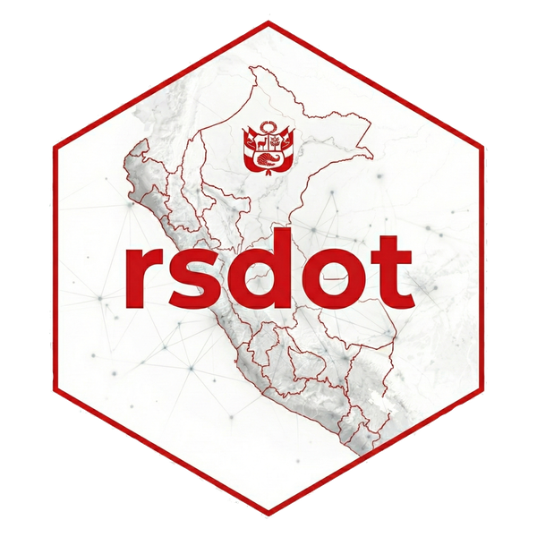
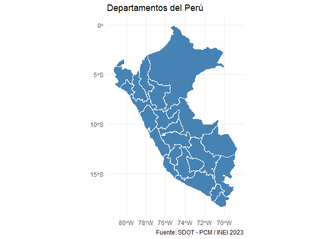
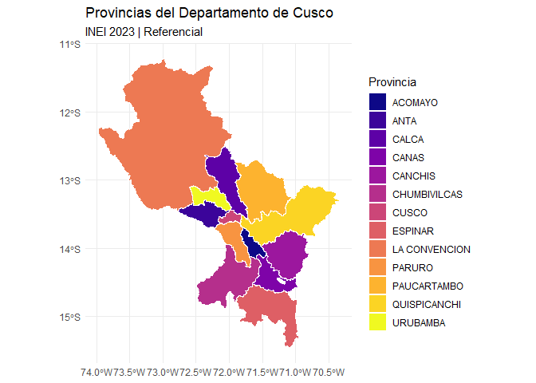
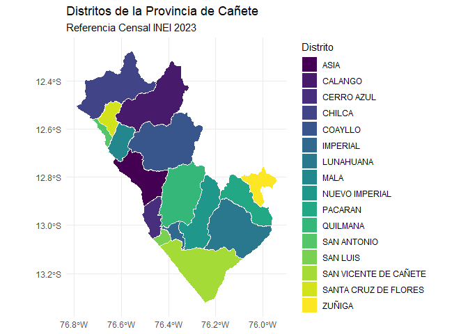
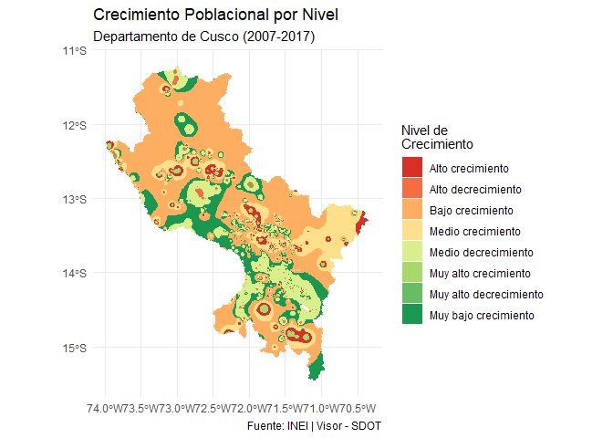
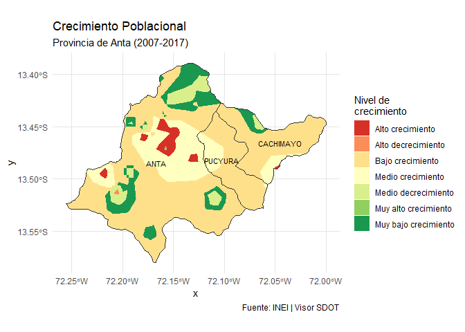
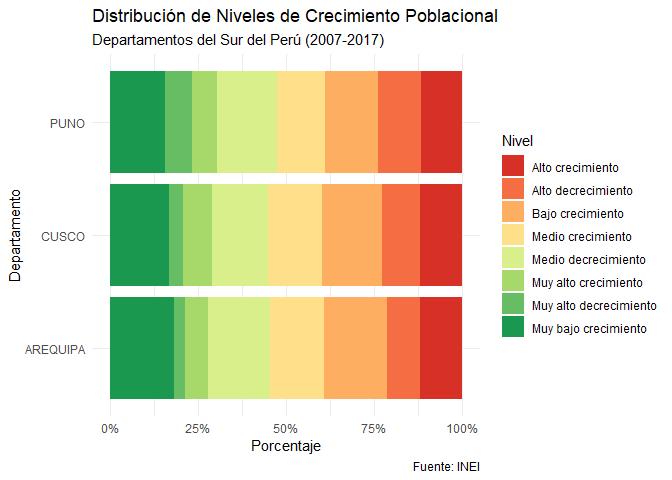

<!-- README.md is generated from README.Rmd. Please edit that file -->

# rsdot <a href='https://github.com/PaulESantos/ppendemic'></a>

<!-- badges: start -->

[](https://lifecycle.r-lib.org/articles/stages.html#experimental)
[](https://CRAN.R-project.org/package=rsdot)
[](https://github.com/PaulESantos/rsdot/actions/workflows/R-CMD-check.yaml)
[](https://app.codecov.io/gh/PaulESantos/rsdot)
<!-- badges: end -->

`rsdot` proporciona acceso programático a la información geográfica
producida y recopilada por la Secretaría de Demarcación y Organización
Territorial (SDOT) de la Presidencia del Consejo de Ministros (PCM) del
Perú.

El paquete facilita el acceso y manipulación de diversas capas
vectoriales, incluyendo:

- **Límites censales INEI 2023**: Departamentos, provincias y distritos
- **Tiempos de desplazamiento**: Accesibilidad territorial a capitales
  departamentales
- **Densidad y crecimiento poblacional**: Interpolación espacial de
  censos 2007-2017
- **Información del modelo geográfico SDOT**: Infraestructura, centros
  poblados, riesgos y peligros
- **Otras capas temáticas territoriales**

### ⚠️ Importante

Los límites censales del INEI provistos por este paquete son
**referenciales** y no constituyen límites oficiales ni tienen efecto
legal demarcatorio.

## ✨ Características

- ✅ **Acceso programático** a datos espaciales oficiales del Perú
- ✅ **Descarga automática** desde OSF con caché inteligente
- ✅ **Compatible** con `sf`, `ggplot2`, `dplyr` y herramientas SIG
  modernas
- ✅ **Validación de geometrías** automática para operaciones espaciales

### 📦 Funciones Disponibles por Dominio Temático

#### 🏛️ Límites Censales y Organización Territorial
- `get_departamentos()` - Límites censales departamentales (INEI 2023).
- `get_provincias(departamento)` - Límites censales provinciales.
- `get_distritos(departamento, provincia)` - Límites censales distritales.
- `get_capitales()` - Coordenadas de capitales departamentales, provinciales y distritales.
- `get_centros_poblados(departamento, ...)` - Centros poblados y asentamientos dispersos.

#### 🛣️ Redes de Transporte y Aeródromos
- `get_red_vial_nacional()` - Red vial nacional (SINAC / MTC).
- `get_red_vial_departamental(departamento, ...)` - Red vial departamental.
- `get_red_vial_vecinal(departamento, ...)` - Red vial vecinal / rural.
- `get_aerodromos(departamento)` - Aeropuertos, aeródromos y pistas de aterrizaje.

#### 🏥 Infraestructura Social y Servicios Públicos
- `get_ipress(departamento, ...)` - Establecimientos de salud (IPRESS - MINSA/SDOT).
- `get_locales_educativos(departamento, ...)` - Locales escolares y educativos (MINEDU).
- `get_servicios_educativos(departamento, ...)` - Servicios educativos por nivel/modalidad.

#### 📈 Demografía y Accesibilidad Territorial
- `get_densidad_poblacional(departamento, ...)` - Densidad poblacional intercensal (2007-2017).
- `get_centros_poblados_crecimiento(departamento)` - Tasa de crecimiento intercensal de centros poblados.
- `get_tiempos_desplazamiento(departamento)` - Isócronas de tiempo de desplazamiento y accesibilidad a capitales.

#### 📶 Telecomunicaciones
- `get_cobertura_movil(departamento, ...)` - Cobertura móvil (2G, 3G, 4G, 5G) por centro poblado.
- `get_cobertura_movil_c(departamento, ...)` - Detalle de servicios de comunicación y estaciones base.

#### 🌋 Peligros y Gestión del Riesgo de Desastres
- `get_peligros(dataset, departamento)` - Áreas de inundación, puntos críticos y movimientos en masa.
- `get_riesgos(dataset, departamento)` - Evaluaciones de riesgo y zonas de riesgo no mitigable.

#### ⚙️ Descubrimiento de Catálogo y Mantenimiento
- `list_available_layers(domain = NULL)` - Consultar el catálogo completo de capas disponibles y sus metadatos.
- `rsdot_check_updates()` - Verificar el estado, peso y fechas de las capas en la caché local.
- `clear_rsdot_cache()` - Limpiar la memoria caché local para liberar espacio o forzar recarga.

---

### 🗺️ Matriz de Cobertura de Capas (GeoSDOT vs rsdot)

| Dominio | Capa Fuente en GeoSDOT | Función en rsdot | Nivel de Partición |
| :--- | :--- | :--- | :--- |
| Límites | `geoportal:v_departamentos_2023` | `get_departamentos()` | Nacional |
| Límites | `geoportal:v_provincias_2023` | `get_provincias()` | Nacional / Departamental |
| Límites | `geoportal:v_distritos_2023` | `get_distritos()` | Nacional / Departamental / Provincial |
| Límites | `geoportal:v_capitales` | `get_capitales()` | Nacional / Departamental |
| Límites | `geoportal:ccpp_asentamientos_dispersos` | `get_centros_poblados()` | Departamental / Provincial / Distrital |
| Transporte | `geoportal:v_red_vial_nacional` | `get_red_vial_nacional()` | Nacional |
| Transporte | `geoportal:v_red_vial_departamental` | `get_red_vial_departamental()` | Departamental / Provincial |
| Transporte | `geoportal:v_red_vial_vecinal` | `get_red_vial_vecinal()` | Departamental / Provincial |
| Transporte | `geoportal:v_aerodromos` | `get_aerodromos()` | Departamental |
| Servicios | `geoportal:v_ipress` | `get_ipress()` | Departamental / Provincial / Distrital |
| Servicios | `geoportal:v_locales_educativos` | `get_locales_educativos()` | Departamental / Provincial / Distrital |
| Servicios | `geoportal:v_servicios_educativos` | `get_servicios_educativos()` | Departamental / Provincial / Distrital |
| Demografía | `geoportal:v_densidad_poblacional` | `get_densidad_poblacional()` | Departamental / Provincial / Distrital |
| Demografía | `geoportal:v_ccpp_crecimiento` | `get_centros_poblados_crecimiento()` | Departamental |
| Accesibilidad | `geoportal:v_tiempo_desplazamiento` | `get_tiempos_desplazamiento()` | Departamental / Polígono personalizado |
| Telecom | `geoportal:cobertura_movil_oper` | `get_cobertura_movil()` | Departamental / Provincial / Distrital |
| Peligros | `geoportal:v_peligros_*` | `get_peligros()` | Departamental |
| Riesgos | `geoportal:v_riesgos_*` | `get_riesgos()` | Departamental |
## 📦 Instalación

Instalar la versión de desarrollo desde GitHub:

``` r
# Usando remotes
install.packages("remotes")
remotes::install_github("PaulESantos/rsdot")

# O usando pak (recomendado)
install.packages("pak")
pak::pak("PaulESantos/rsdot")
```

## 🚀 Ejemplos de uso

### Cargar el paquete

``` r
library(rsdot)
library(sf)
#> Linking to GEOS 3.13.1, GDAL 3.10.2, PROJ 9.5.1; sf_use_s2() is TRUE
library(ggplot2)
library(dplyr)
#> 
#> Adjuntando el paquete: 'dplyr'
#> The following objects are masked from 'package:stats':
#> 
#>     filter, lag
#> The following objects are masked from 'package:base':
#> 
#>     intersect, setdiff, setequal, union
```

### 1. Límites censales

#### Obtener departamentos

``` r
deps <- get_departamentos()
#> Descargando: Límites Censales Departamentales (INEI 2023)...
#> Fuente: OSF - Repositorio DEMARCA
#> ✓ Descarga completada
#> Descomprimiendo archivos...
#> Cargando geometrías...
#> ✓ Datos cargados: 25 departamentos
deps
#> Simple feature collection with 25 features and 7 fields
#> Geometry type: MULTIPOLYGON
#> Dimension:     XY
#> Bounding box:  xmin: -81.32823 ymin: -18.35093 xmax: -68.65228 ymax: -0.03860597
#> Geodetic CRS:  WGS 84
#> # A tibble: 25 × 8
#>      gid iddpto nombdep      capital      tipo_norma numero fecha     
#>    <int> <chr>  <chr>        <chr>        <chr>      <chr>  <date>    
#>  1     1 01     AMAZONAS     CHACHAPOYAS  LEY        S/N    1832-11-21
#>  2     2 02     ANCASH       HUARAZ       LEY        S/N    1851-11-05
#>  3     3 03     APURIMAC     ABANCAY      LEY        S/N    1873-04-28
#>  4     4 04     AREQUIPA     AREQUIPA     REGLAMENTO S/N    1822-04-26
#>  5     5 05     AYACUCHO     AYACUCHO     REGLAMENTO S/N    1822-04-26
#>  6     6 06     CAJAMARCA    CAJAMARCA    LEY        S/N    1857-01-02
#>  7     7 07     CALLAO       CALLAO       <NA>       <NA>   NA        
#>  8     8 08     CUSCO        CUSCO        REGLAMENTO S/N    1822-04-26
#>  9     9 09     HUANCAVELICA HUANCAVELICA LEY        S/N    1857-01-02
#> 10    10 10     HUANUCO      HUANUCO      LEY        S/N    1869-01-24
#> # ℹ 15 more rows
#> # ℹ 1 more variable: geometry <MULTIPOLYGON [°]>

# Visualización básica
ggplot(deps) +
  geom_sf(fill = "steelblue", color = "white") +
  theme_minimal() +
  labs(
    title = "Departamentos del Perú",
    caption = "Fuente: SDOT - PCM / INEI 2023"
  )
```



#### Obtener provincias de un departamento

``` r
cusco_prov <- get_provincias(departamento = "CUSCO")
#> Descargando: Límites Censales Provinciales (INEI 2023)...
#> Fuente: OSF - Repositorio DEMARCA
#> ✓ Descarga completada
#> Descomprimiendo archivos...
#> Cargando geometrías...
#> ✓ Filtrado por departamento: 13 provincia(s) en CUSCO
#> ✓ Datos cargados: 13 provincia(s)
head(cusco_prov)
#> Simple feature collection with 6 features and 9 fields
#> Geometry type: MULTIPOLYGON
#> Dimension:     XY
#> Bounding box:  xmin: -72.77286 ymin: -14.88788 xmax: -70.78982 ymax: -12.50659
#> Geodetic CRS:  WGS 84
#> # A tibble: 6 × 10
#>     gid iddpto nombdep idprov nombprov     capital  tipo_norma numero fecha     
#>   <int> <chr>  <chr>   <chr>  <chr>        <chr>    <chr>      <chr>  <date>    
#> 1     3 08     CUSCO   0802   ACOMAYO      ACOMAYO  Ley        S/N    1861-02-23
#> 2     9 08     CUSCO   0803   ANTA         ANTA     Ley        S/N    1839-11-19
#> 3    28 08     CUSCO   0804   CALCA        CALCA    Reglament… S/N    1825-06-21
#> 4    31 08     CUSCO   0805   CANAS        YANAOCA  Ley        S/N    1833-10-14
#> 5    32 08     CUSCO   0806   CANCHIS      SICUANI  Ley        S/N    1833-10-14
#> 6    54 08     CUSCO   0807   CHUMBIVILCAS SANTO T… Reglament… S/N    1825-06-21
#> # ℹ 1 more variable: geometry <MULTIPOLYGON [°]>

# Mapa de provincias
ggplot(cusco_prov) +
  geom_sf(aes(fill = nombprov), color = "white", linewidth = 0.3) +
  scale_fill_viridis_d(option = "plasma") +
  theme_minimal() +
  labs(
    title = "Provincias del Departamento de Cusco",
    subtitle = "INEI 2023 | Referencial",
    fill = "Provincia"
  )
```



#### Obtener distritos

Ejemplo: Cañete (Lima)

``` r
canete <- get_distritos(
  provincia = "CAÑETE",
  departamento = "LIMA"
)
#> Descargando: Límites Censales Distritales (INEI 2023)...
#> Fuente: OSF - Repositorio DEMARCA
#> Nota: Este es un archivo grande, puede tardar varios minutos...
#> ✓ Descarga completada
#> Descomprimiendo archivos...
#> Cargando geometrías distritales...
#> ✓ Filtrado por departamento: 171 distrito(s) en LIMA
#> ✓ Filtrado por provincia: 16 distrito(s) en CAÑETE
#> ✓ Filtrado completado por departamento > provincia: 16 distrito(s)

# Visualización
ggplot(canete) +
  geom_sf(aes(fill = nombdist), color = "white", linewidth = 0.3) +
  scale_fill_viridis_d() +
  theme_minimal() +
  labs(
    title = "Distritos de la Provincia de Cañete",
    subtitle = "Referencia Censal INEI 2023",
    fill = "Distrito"
  )
```



### 2. Tiempos de desplazamiento

``` r
# Cargar límites de Cusco
cusco <- get_departamentos(departamento = "CUSCO")

# Obtener tiempos de desplazamiento
tiempos_cusco <- get_tiempos_desplazamiento(area_interes = cusco)

# Visualizar accesibilidad territorial
ggplot() +
  geom_sf(data = tiempos_cusco, aes(fill = cat_tiempo), color = NA) +
  geom_sf(data = cusco, fill = NA, color = "black", linewidth = 1) +
  scale_fill_brewer(palette = "YlOrRd", name = "Tiempo", direction = -1) +
  labs(
    title = "Tiempo de Desplazamiento a Capital más Cercana",
    subtitle = "Departamento de Cusco",
    caption = "Fuente: INEI - MTC | Visor - SDOT"
  ) +
  theme_void()
```

### 3. Densidad y crecimiento poblacional

#### Ver departamentos disponibles

``` r
# Listar departamentos con datos disponibles
get_densidad_poblacional()
#> Departamentos disponibles:
#>   - AMAZONAS
#>   - ANCASH
#>   - APURIMAC
#>   - AREQUIPA
#>   - AYACUCHO
#>   - CAJAMARCA
#>   - CALLAO
#>   - CUSCO
#>   - HUANCAVELICA
#>   - HUANUCO
#>   - ICA
#>   - JUNIN
#>   - LA LIBERTAD
#>   - LAMBAYEQUE
#>   - LIMA
#>   - LORETO
#>   - MADRE DE DIOS
#>   - MOQUEGUA
#>   - PASCO
#>   - PIURA
#>   - PUNO
#>   - SAN MARTIN
#>   - TACNA
#>   - TUMBES
#>   - UCAYALI
#> 
#> Uso: get_densidad_poblacional(departamento = 'CUSCO')
```

#### Cargar datos de un departamento

``` r
densidad_cusco <- get_densidad_poblacional(departamento = "CUSCO")
#> Descargando: CUSCO...
#> ✓ Descarga completada: CUSCO
#> Cargando datos: CUSCO...
#> Validando geometrías...
#> ✓ Cargado: CUSCO (649 registros)
#> ✓ Datos cargados exitosamente: 649 registros
densidad_cusco
#> Simple feature collection with 649 features and 11 fields
#> Geometry type: MULTIPOLYGON
#> Dimension:     XY
#> Bounding box:  xmin: -73.9811 ymin: -15.45829 xmax: -70.34507 ymax: -11.21229
#> Geodetic CRS:  WGS 84
#> # A tibble: 649 × 12
#>    ubigeo nombdep nombprov     nombdist   capital nivel rango descrip shape_leng
#>  * <chr>  <chr>   <chr>        <chr>      <chr>   <chr> <chr> <chr>        <dbl>
#>  1 080703 CUSCO   CHUMBIVILCAS CHAMACA    CHAMACA Muy … <= -… Tasa m…    0.0302 
#>  2 080707 CUSCO   CHUMBIVILCAS QUIÑOTA    QUIÑOTA Muy … <= -… Tasa m…    0.00842
#>  3 080202 CUSCO   ACOMAYO      ACOPIA     ACOPIA  Muy … <= -… Tasa m…    0.0154 
#>  4 080701 CUSCO   CHUMBIVILCAS SANTO TOM… SANTO … Muy … <= -… Tasa m…    0.118  
#>  5 081002 CUSCO   PARURO       ACCHA      ACCHA   Muy … <= -… Tasa m…    0.0240 
#>  6 080501 CUSCO   CANAS        YANAOCA    YANAOCA Muy … <= -… Tasa m…    0.0302 
#>  7 080506 CUSCO   CANAS        PAMPAMARCA PAMPAM… Muy … <= -… Tasa m…    0.00743
#>  8 080601 CUSCO   CANCHIS      SICUANI    SICUANI Muy … <= -… Tasa m…    0.0347 
#>  9 081207 CUSCO   QUISPICANCHI HUARO      HUARO   Muy … <= -… Tasa m…    0.0232 
#> 10 080806 CUSCO   ESPINAR      PICHIGUA   PICHIG… Muy … <= -… Tasa m…    0.0273 
#> # ℹ 639 more rows
#> # ℹ 3 more variables: shape_area <dbl>, geom <MULTIPOLYGON [°]>,
#> #   departamento <chr>

# Mapa de nivel de crecimiento
ggplot(densidad_cusco) +
  geom_sf(aes(fill = nivel), color = NA) +
  scale_fill_brewer(
    palette = "RdYlGn",
    name = "Nivel de\nCrecimiento"
  ) +
  labs(
    title = "Crecimiento Poblacional por Nivel",
    subtitle = "Departamento de Cusco (2007-2017)",
    caption = "Fuente: INEI | Visor - SDOT"
  ) +
  theme_minimal()
```



#### Filtrado por provincia y distrito

``` r
# Cargar solo una provincia
densidad_prov_cusco <- get_densidad_poblacional(
  departamento = "CUSCO",
  provincia = "CUSCO"
)
#> ✓ Usando caché: CUSCO
#> Cargando datos: CUSCO...
#> Validando geometrías...
#> ✓ Cargado: CUSCO (649 registros)
#> ✓ Filtrado por provincia: 36 registros
#> ✓ Datos cargados exitosamente: 36 registros

# Cargar distrito específico
densidad_wanchaq <- get_densidad_poblacional(
  departamento = "CUSCO",
  provincia = "CUSCO",
  distrito = "WANCHAQ"
)
#> ✓ Usando caché: CUSCO
#> Cargando datos: CUSCO...
#> Validando geometrías...
#> ✓ Cargado: CUSCO (649 registros)
#> ✓ Filtrado por provincia: 36 registros
#> ✓ Filtrado por distrito: 3 registros
#> ✓ Datos cargados exitosamente: 3 registros
```

#### Análisis avanzado: Mapa con etiquetas de distritos

``` r
prov_anta <- get_densidad_poblacional(
  departamento = "CUSCO",
  provincia = "ANTA", 
  distrito = c("CACHIMAYO", "PUCYURA", "ANTA"))
#> ✓ Usando caché: CUSCO
#> Cargando datos: CUSCO...
#> Validando geometrías...
#> ✓ Cargado: CUSCO (649 registros)
#> ✓ Filtrado por provincia: 43 registros
#> ✓ Filtrado por distrito: 14 registros
#> ✓ Datos cargados exitosamente: 14 registros

distritos_anta <- prov_anta |>
   group_by(ubigeo, nombdist) |>
   summarise(.groups = "drop")
 distritos_anta
#> Simple feature collection with 3 features and 2 fields
#> Geometry type: POLYGON
#> Dimension:     XY
#> Bounding box:  xmin: -72.25564 ymin: -13.58002 xmax: -72.00001 ymax: -13.38918
#> Geodetic CRS:  WGS 84
#> # A tibble: 3 × 3
#>   ubigeo nombdist                                                           geom
#>   <chr>  <chr>                                                     <POLYGON [°]>
#> 1 080301 ANTA      ((-72.23544 -13.49333, -72.23555 -13.49369, -72.23601 -13.49…
#> 2 080303 CACHIMAYO ((-72.07001 -13.43834, -72.07265 -13.43639, -72.07554 -13.43…
#> 3 080308 PUCYURA   ((-72.06076 -13.50311, -72.0618 -13.50156, -72.06236 -13.501…
# Calcular centroides para etiquetas
distritos_centroides <- st_point_on_surface(distritos_anta)
#> Warning: st_point_on_surface assumes attributes are constant over geometries
#> Warning in st_point_on_surface.sfc(st_geometry(x)): st_point_on_surface may not
#> give correct results for longitude/latitude data

# Mapa completo
ggplot() +
  # 1. Celdas con el nivel de crecimiento
  geom_sf(
    data = prov_anta,
    aes(fill = nivel),
    color = NA
  ) +
  # 2. Contorno de distritos
  geom_sf(
    data = distritos_anta,
    fill  = NA,
    color = "grey20",
    linewidth = 0.4
  ) +
  # 3. Nombres de los distritos
  geom_sf_text(
    data = distritos_centroides,
    aes(label = nombdist),
    size = 3
  ) +
  scale_fill_brewer(
    palette = "RdYlGn",
    name = "Nivel de\ncrecimiento"
  ) +
  labs(
    title = "Crecimiento Poblacional",
    subtitle = "Provincia de Anta (2007-2017)",
    caption = "Fuente: INEI | Visor SDOT"
  ) +
  theme_minimal() +
  theme(
    legend.position = "right",
    panel.grid.major = element_line(linewidth = 0.2, colour = "grey90")
  )
#> Warning in st_point_on_surface.sfc(sf::st_zm(x)): st_point_on_surface may not
#> give correct results for longitude/latitude data
```



#### Cargar múltiples departamentos

``` r
# Cargar varios departamentos del sur
densidad_sur <- get_densidad_poblacional(
  departamento = c("CUSCO", "PUNO", "AREQUIPA")
)
#> Descargando: AREQUIPA...
#> ✓ Descarga completada: AREQUIPA
#> Cargando datos: AREQUIPA...
#> Validando geometrías...
#> ✓ Cargado: AREQUIPA (516 registros)
#> ✓ Usando caché: CUSCO
#> Cargando datos: CUSCO...
#> Validando geometrías...
#> ✓ Cargado: CUSCO (649 registros)
#> Descargando: PUNO...
#> ✓ Descarga completada: PUNO
#> Cargando datos: PUNO...
#> Validando geometrías...
#> ✓ Cargado: PUNO (631 registros)
#> Combinando datos de múltiples departamentos...
#> ✓ Datos cargados exitosamente: 1796 registros

# Análisis estadístico por departamento
densidad_sur %>%
  st_drop_geometry() %>%
  count(nombdep, nivel) %>%
  ggplot(aes(x = nombdep, y = n, fill = nivel)) +
  geom_col(position = "fill") +
  scale_y_continuous(labels = scales::percent) +
  scale_fill_brewer(palette = "RdYlGn", name = "Nivel") +
  labs(
    title = "Distribución de Niveles de Crecimiento Poblacional",
    subtitle = "Departamentos del Sur del Perú (2007-2017)",
    x = "Departamento",
    y = "Porcentaje",
    caption = "Fuente: INEI"
  ) +
  coord_flip() +
  theme_minimal()
```



## 📊 Fuentes de datos

Los datos provistos por este paquete provienen de:

- **SDOT-PCM** - Secretaría de Demarcación y Organización Territorial
  - <https://geosdot.servicios.gob.pe/visor/>

## 🤝 Contribuciones

Las contribuciones son bienvenidas. Por favor abre un issue o pull
request:

👉 <https://github.com/PaulESantos/rsdot/issues>

## 📄 Licencia

Este paquete utiliza la licencia MIT. Consulta `LICENSE` para más
detalles.

## 👤 Autor

**Paul Efren Santos Andrade**

- ORCID: [0000-0002-6635-0375](https://orcid.org/0000-0002-6635-0375)
- Email: <paulefrens@gmail.com>

## 🌐 Sitio web del paquete

Documentación ampliada y viñetas:

👉 <https://paulesantos.github.io/rsdot/>

## 📚 Citación

Si utilizas este paquete en tus publicaciones, por favor cítalo como:

``` r
citation("rsdot")
#> To cite package 'rsdot' in publications use:
#> 
#>   Santos Andrade P (2025). _rsdot: Acceso Programático a Datos
#>   Espaciales de la SDOT-PCM Perú_. R package version 0.1.0, commit
#>   24c8a524a71cfefcf5255671f14a2a23d6864ab6,
#>   <https://github.com/PaulESantos/rsdot>.
#> 
#> A BibTeX entry for LaTeX users is
#> 
#>   @Manual{,
#>     title = {rsdot: Acceso Programático a Datos Espaciales de la SDOT-PCM Perú},
#>     author = {Paul Efren {Santos Andrade}},
#>     year = {2025},
#>     note = {R package version 0.1.0, commit 24c8a524a71cfefcf5255671f14a2a23d6864ab6},
#>     url = {https://github.com/PaulESantos/rsdot},
#>   }
```
