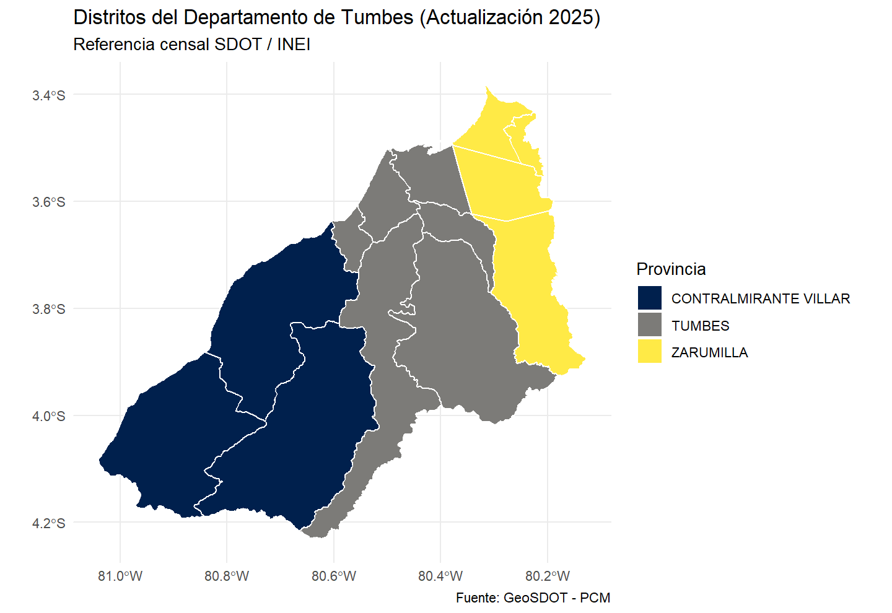
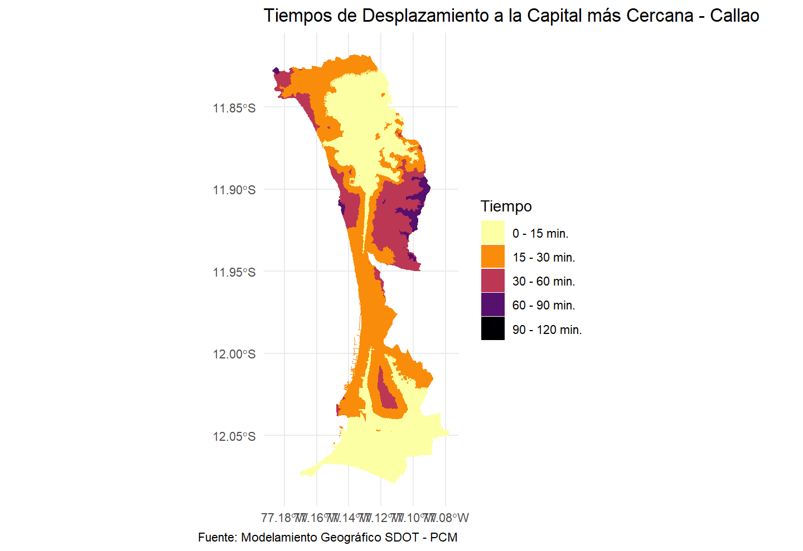

## Introducción

A partir de la versión `0.2.0`, `rsdot` amplía su cobertura territorial conectando directamente con las capas de modelamiento geográfico, flujos de movilidad y límites censales actualizados (2025) alojadas en el repositorio OSF de SDOT-PCM.

En esta viñeta se muestra cómo acceder y visualizar:

1. **Límites distritales actualizados 2025**: `get_distritos_2025()` y `get_distritos(ano = 2025)`.
2. **Densidades de actividades económicas y viviendas**: `get_densidad_comercio()`, `get_densidad_viviendas()`, `get_densidad_mercados()`, `get_densidad_financiero()` y `get_densidad_inmobiliario()`.
3. **Valor Agregado Bruto (VAB) de Centros Poblados**: `get_vab_ccpp()`.
4. **Flujos de movilidad interdistrital**: `get_flujos_estudiantes()` y `get_flujos_trabajadores()`.
5. **Tiempos de desplazamiento a la capital más cercana**: `get_tiempos_desplazamiento()`.


``` r
library(rsdot)
library(sf)
library(dplyr)
library(ggplot2)
```

## 1. Límites Distritales Actualizados (2025)

La función `get_distritos_2025()` descarga el GeoPackage oficial con la actualización distrital 2025 y permite filtrar por departamento, provincia o distrito de forma insensible a mayúsculas.


``` r
tumbes_2025 <- get_distritos_2025(departamento = "TUMBES", show_progress = FALSE)
nrow(tumbes_2025)
#> [1] 13
head(tumbes_2025[, c("ubigeo", "nombdep", "nombprov", "nombdist")])
#> Simple feature collection with 6 features and 4 fields
#> Geometry type: MULTIPOLYGON
#> Dimension:     XY
#> Bounding box:  xmin: -80.86155 ymin: -4.2319 xmax: -80.18069 ymax: -3.485219
#> Geodetic CRS:  WGS 84
#> # A tibble: 6 × 5
#>   ubigeo nombdep nombprov              nombdist                             geom
#>   <chr>  <chr>   <chr>                 <chr>                  <MULTIPOLYGON [°]>
#> 1 240101 TUMBES  TUMBES                TUMBES          (((-80.40358 -3.485408, …
#> 2 240104 TUMBES  TUMBES                PAMPAS DE HOSP… (((-80.434 -3.658768, -8…
#> 3 240105 TUMBES  TUMBES                SAN JACINTO     (((-80.43971 -3.626115, …
#> 4 240106 TUMBES  TUMBES                SAN JUAN DE LA… (((-80.44683 -3.598937, …
#> 5 240201 TUMBES  CONTRALMIRANTE VILLAR ZORRITOS        (((-80.60283 -3.639535, …
#> 6 240202 TUMBES  CONTRALMIRANTE VILLAR CASITAS         (((-80.60814 -3.823062, …
```


``` r
ggplot(tumbes_2025) +
  geom_sf(aes(fill = nombprov), color = "white", linewidth = 0.4) +
  scale_fill_viridis_d(option = "cividis", name = "Provincia") +
  theme_minimal() +
  labs(
    title = "Distritos del Departamento de Tumbes (Actualización 2025)",
    subtitle = "Referencia censal SDOT / INEI",
    caption = "Fuente: GeoSDOT - PCM"
  )
```

<div class="figure">

<p class="caption">plot of chunk plot-distritos-2025</p>
</div>

## 2. Modelamiento Geográfico: Densidades y VAB

Las grillas de densidad permiten identificar polos de concentración comercial, financiera, inmobiliaria, de mercados y de viviendas. Todas comparten una estructura uniforme y pueden filtrarse espacialmente por departamento.


``` r
dens_com <- get_densidad_comercio(show_progress = FALSE)
dens_com |>
  st_drop_geometry() |>
  select(gridcode, nivel, rango)
#> # A tibble: 5 × 3
#>   gridcode nivel                          rango                   
#>      <dbl> <chr>                          <chr>                   
#> 1        1 Densidad Muy Baja de comercios 29 - 120 comercios/km2  
#> 2        2 Densidad Baja de comercios     120 - 280 comercios/km2 
#> 3        3 Densidad Media de comercios    280 - 560 comercios/km2 
#> 4        4 Densidad Alta de comercios     560 - 1100 comercios/km2
#> 5        5 Densidad Muy Alta de comercios > 1100 comercios/km2
```

También es posible consultar el **Valor Agregado Bruto (VAB)** modelado a nivel de centros poblados (grilla de 150 m) para Lima Metropolitana, Callao o el ámbito nacional (`"total"`).


``` r
vab_callao <- get_vab_ccpp(cobertura = "callao", show_progress = FALSE)
nrow(vab_callao)
#> [1] 7
head(st_drop_geometry(vab_callao))
#> # A tibble: 6 × 26
#>   ubigeo codcp      departamen provincia distrito cen_pob    pob    viv viv_part
#>   <chr>  <chr>      <chr>      <chr>     <chr>    <chr>    <dbl>  <dbl>    <dbl>
#> 1 070101 0701010001 CALLAO     CALLAO    CALLAO   CALLAO  451260 119397   119033
#> 2 070102 0701020001 CALLAO     CALLAO    BELLAVI… BELLAV…  74851  20630    20578
#> 3 070103 0701030001 CALLAO     CALLAO    CARMEN … CARMEN…  42240  11234    11222
#> 4 070104 0701040001 CALLAO     CALLAO    LA PERLA LA PER…  61417  18537    18526
#> 5 070105 0701050001 CALLAO     CALLAO    LA PUNTA LA PUN…   3829   1466     1462
#> 6 070106 0701060001 CALLAO     CALLAO    VENTANI… VENTAN… 315600  99230    99166
#> # ℹ 17 more variables: viv_part_o <dbl>, viv_part_1 <dbl>, pob_viv_pa <dbl>,
#> #   y <dbl>, x <dbl>, fuente_fin <chr>, revision <chr>, estado_coo <chr>,
#> #   empate <chr>, ubigeo1 <chr>, r <chr>, dfp <chr>, urb_rur <chr>,
#> #   obs_u_r <chr>, idprov <chr>, capital <chr>, vab_total <dbl>
```

## 3. Flujos de Movilidad Interdistrital

Las capas de análisis geográfico representan vectores origen-destino diarios para estudiantes y trabajadores segmentados por rangos de volumen de viajes.


``` r
# Flujos de estudiantes entre 100 y 1,000 viajes
flujos_est <- get_flujos_estudiantes(rango = "100_1000", show_progress = FALSE)
nrow(flujos_est)
#> [1] 2964
head(st_drop_geometry(flujos_est))
#> # A tibble: 6 × 13
#>   salen  dep_salen prov_salen dist_salen entran dep_entran prov_entra dist_entra
#>   <chr>  <chr>     <chr>      <chr>      <chr>  <chr>      <chr>      <chr>     
#> 1 010101 AMAZONAS  CHACHAPOY… CHACHAPOY… 010307 AMAZONAS   BONGARA    JAZAN     
#> 2 010101 AMAZONAS  CHACHAPOY… CHACHAPOY… 010701 AMAZONAS   UTCUBAMBA  BAGUA GRA…
#> 3 010201 AMAZONAS  BAGUA      BAGUA      010203 AMAZONAS   BAGUA      COPALLIN  
#> 4 010201 AMAZONAS  BAGUA      BAGUA      010206 AMAZONAS   BAGUA      LA PECA   
#> 5 010201 AMAZONAS  BAGUA      BAGUA      010701 AMAZONAS   UTCUBAMBA  BAGUA GRA…
#> 6 010201 AMAZONAS  BAGUA      BAGUA      010704 AMAZONAS   UTCUBAMBA  EL MILAGRO
#> # ℹ 5 more variables: x_salen <dbl>, y_salen <dbl>, valor <dbl>, hubname <chr>,
#> #   hubdist <dbl>
```

## 4. Tiempos de Desplazamiento a la Capital más Cercana

La función `get_tiempos_desplazamiento()` devuelve las isócronas departamentales de accesibilidad hacia la capital más cercana.


``` r
tiempos_callao <- get_tiempos_desplazamiento(departamento = "CALLAO", show_progress = FALSE)
tiempos_callao |>
  st_drop_geometry() |>
  head(5)
#> # A tibble: 5 × 6
#>   dn    cat_tiempo    fid_origen capa    nombdep iddpto
#>   <chr> <chr>              <dbl> <chr>   <chr>   <chr> 
#> 1 2     15 - 30 min.       33579 15_lima CALLAO  07    
#> 2 4     60 - 90 min.       26041 15_lima CALLAO  07    
#> 3 3     30 - 60 min.       27556 15_lima CALLAO  07    
#> 4 5     90 - 120 min.      28339 15_lima CALLAO  07    
#> 5 4     60 - 90 min.       29406 15_lima CALLAO  07
```


``` r
ggplot(tiempos_callao) +
  geom_sf(aes(fill = cat_tiempo), color = NA) +
  scale_fill_viridis_d(option = "inferno", direction = -1, name = "Tiempo") +
  theme_minimal() +
  labs(
    title = "Tiempos de Desplazamiento a la Capital más Cercana - Callao",
    caption = "Fuente: Modelamiento Geográfico SDOT - PCM"
  )
```

<div class="figure">

<p class="caption">plot of chunk plot-tiempos-callao</p>
</div>
