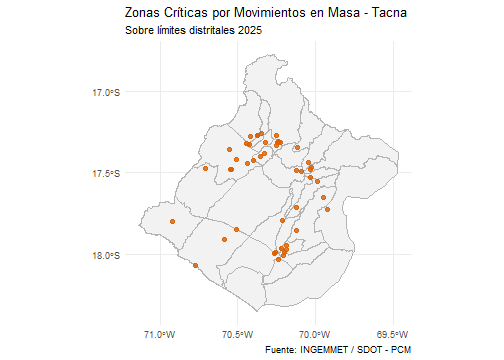

## Introducción

El paquete `rsdot` centraliza **182 archivos departamentales** de gestión de riesgos de desastres y peligros naturales (ANA, INGEMMET, CENEPRED), además de la capa de catastro rural (MIDAGRI).

Esta viñeta presenta cómo consultar estas capas mediante las funciones genéricas (`get_peligros()`, `get_riesgos()`) y sus funciones atajo especializadas:

* **Peligros por inundación**: `get_puntos_criticos()`, `get_tramos_criticos()`, `get_areas_inundacion()`, `get_inventario_inundaciones()`.
* **Peligros por movimientos en masa**: `get_zonas_criticas()`, `get_areas_movimientos_masa()`.
* **Riesgos de desastres**: `get_evaluacion_riesgos()`, `get_zonas_riesgos_no_mitigable()`.
* **Catastro rural**: `get_catastro_rural()`.


``` r
library(rsdot)
library(sf)
library(dplyr)
library(ggplot2)
```

## 1. Peligros Naturales

Para explorar los tipos de peligro y departamentos disponibles, se puede invocar `get_peligros()` sin argumentos:


``` r
get_peligros()
```

### Puntos críticos de inundaciones

Los puntos críticos identifican tramos vulnerables de ríos y quebradas ante desbordes. Podemos descargar directamente un departamento con `get_puntos_criticos()`:


``` r
pc_callao <- get_puntos_criticos(departamento = "CALLAO", show_progress = FALSE)
nrow(pc_callao)
#> [1] 10
pc_callao |>
  st_drop_geometry() |>
  select(nom_dist, nomb_rio_q, tip_peligr, familias_e) |>
  head(5)
#> # A tibble: 5 × 4
#>   nom_dist                   nomb_rio_q tip_peligr      familias_e
#>   <chr>                      <chr>      <chr>                <dbl>
#> 1 CARMEN DE LA LEGUA REYNOSO RIO RIMAC  INUNDACION              NA
#> 2 CARMEN DE LA LEGUA REYNOSO RIO RIMAC  EROSION FLUVIAL         NA
#> 3 CARMEN DE LA LEGUA REYNOSO RIO RIMAC  INUNDACION              NA
#> 4 CARMEN DE LA LEGUA REYNOSO RIO RIMAC  EROSION FLUVIAL         NA
#> 5 CARMEN DE LA LEGUA REYNOSO RIO RIMAC  INUNDACION              NA
```

### Zonas críticas por movimientos en masa


``` r
zc_tacna <- get_zonas_criticas(departamento = "TACNA", show_progress = FALSE)
nrow(zc_tacna)
#> [1] 46
```


``` r
lim_tacna <- get_distritos_2025(departamento = "TACNA", show_progress = FALSE)

ggplot() +
  geom_sf(data = lim_tacna, fill = "grey95", color = "grey70", linewidth = 0.3) +
  geom_sf(data = zc_tacna, color = "#d95f02", size = 1.8, alpha = 0.8) +
  theme_minimal() +
  labs(
    title = "Zonas Críticas por Movimientos en Masa - Tacna",
    subtitle = "Sobre límites distritales 2025",
    caption = "Fuente: INGEMMET / SDOT - PCM"
  )
```



## 2. Riesgos de Desastres

Las capas de riesgos cubren las evaluaciones de riesgo (`get_evaluacion_riesgos()`, disponible en los 25 departamentos) y las zonas declaradas de riesgo no mitigable (`get_zonas_riesgos_no_mitigable()`, disponible en 9 departamentos).


``` r
# Listar departamentos con zonas de riesgo no mitigable
get_zonas_riesgos_no_mitigable()

# Descargar evaluación de riesgos para Callao
evar_callao <- get_evaluacion_riesgos(departamento = "CALLAO", show_progress = FALSE)
nrow(evar_callao)
#> [1] 41
```

## 3. Catastro Rural (MIDAGRI)

La función `get_catastro_rural()` permite consultar los predios rurales catastrados por departamento (disponible en modo local/staging mientras se completa su publicación en OSF):

```r
# Consultar departamentos disponibles en staging local
options(rsdot.use_staging = TRUE)
get_catastro_rural()
```
